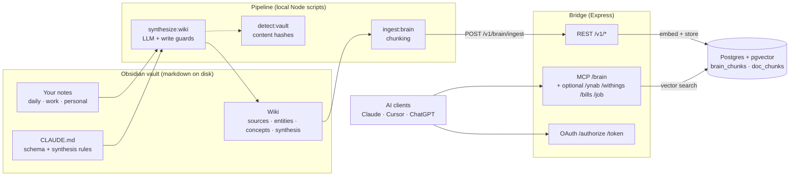

# canonical-wiki

A personal knowledge system where an agent-maintained Obsidian wiki is the source of truth, and Postgres/pgvector is a disposable index served over MCP.

Most "chat with your notes" setups treat the vector index as the memory. Chunks get re-embedded from summaries of summaries, numbers fall out, and the thing the model retrieves slowly stops matching anything you wrote. When it goes wrong you cannot tell what was lost, because the index is the only copy of the synthesis.

The wiki is the source of truth; the RAG index is a derived cache. An LLM pipeline reads your raw notes and maintains a wiki of plain markdown pages (sources, entities, concepts, syntheses) inside your Obsidian vault. Postgres with pgvector holds chunks of those pages and nothing else. You can drop the database and rebuild it with one command. You cannot lose knowledge that way, and if a fact is wrong you fix the page, not a row.

This repo is the two pieces, designed together. A vault schema (`vault-template/CLAUDE.md`) tells any coding agent, and the synthesis pipeline itself, how the wiki is organised. A small Express server, the bridge, indexes the wiki and serves it to AI clients over MCP and REST. Optional connectors (YNAB, Withings, bills, job documents) show how other personal data plugs into the same server. They are off unless you add them to `ENABLED_MODULES`.

## Architecture

You write notes in Obsidian as usual. `npm run sync:wiki` runs three steps in a fixed order. First, `synthesize:wiki` finds notes whose content hash changed. It asks an LLM for a plan and writes pages. Narrative notes become summarised source pages. Fact-dense notes become extractive pages that copy the data verbatim. Before any page is written, guards check that its `title` matches the target file, that it did not collapse into a placeholder or shrink drastically, and that it kept at least 90% of the hard facts of the old version. Second, `detect:vault` reports what changed, without moving the checkpoint, so a failed note is retried on the next run. Third, `ingest:brain` splits each wiki page by section and sends the chunks to the bridge. The bridge embeds and stores them, and pages deleted from the wiki are pruned from the index. On the query side, an MCP client calls `search_brain`, `find_related`, or `get_brain_page` and gets chunks with the page they came from.

Why it is built this way is the set of decisions in `docs/adr/`. How fidelity is measured is `docs/evals.md`. What a run costs at list price is `docs/costs.md`.

## Quickstart

You need Node 24, Docker, and an OpenAI key for embeddings.

1. `docker compose up -d`
2. `cp .env.example .env`, then set `BRIDGE_API_KEY` (`openssl rand -base64 32`), `OPENAI_API_KEY`, and `OBSIDIAN_VAULT_PATH` to an absolute path of a **copy** of `examples/demo-vault`. The pipeline writes into the vault, so never point it at the committed folder.
3. `npm install && npm start`. The bridge creates the tables on boot. Check with `curl localhost:3000/health`.
4. `npm run ingest:brain` embeds the demo wiki (a few cents at list price).
5. Connect a client: `POST http://localhost:3000/brain` with `Authorization: Bearer <key>`. The initialize request is in `docs/architecture.md`.
6. Optional: edit a note in the copy and run `npm run sync:wiki`. This calls a chat model and costs money. See `docs/costs.md`.

Or open the repo in Claude Code or Cursor and run `/init-brain` (`AGENTS.md`, `skills/init-brain/SKILL.md`).

`examples/demo-vault` is a fictional vault in Spanish (Alex Rivera, Grayhaven, Harbor Permits) with a wiki you can ingest before spending anything on synthesis. `vault-template/` is the empty skeleton for a vault of your own.

## Optional modules

`ENABLED_MODULES=brain` is the default. Adding `ynab`, `withings`, `bills`, or `job` mounts routes and MCP tools that already exist. Credentials are in `.env.example`. YNAB is the only module with write tools. Bills and job share `doc_chunks`, separated by the `factura_` prefix. Withings has its own OAuth flow with the vendor. `monthly` and `prep:121` are optional reports. They can use the Claude Code CLI, and the monthly report can also use the chat API. Neither runs unless you invoke it.

## Known limits

- **Spanish-first pipeline.** Synthesis prompts, the daily-note template, and the 1:1 conventions are in Spanish, and some parsers depend on them. The schema and these docs are in English. Notes in other languages synthesise, but the 1:1 and daily-template features expect the Spanish headings (`## Trabajo`, `## Notas rápidas`, `## Páginas hijas`, `## Archivo`).
- Single user. One Withings account (`withings_oauth` has a single row), one wiki writer at a time, no queue.
- OAuth codes, access tokens, and rate-limit counters live in process memory. A restart drops them. The API key keeps working.
- No PKCE and no `.well-known` OAuth metadata. Clients that require dynamic discovery need the key configured by hand.
- Embeddings need an OpenAI key and are computed server-side, one chunk at a time. There is no local embedder.
- `eval:wiki` snapshots and restores the wiki. Run it only on a copy.
- Bills OCR needs Poppler (`pdftoppm`) on the machine that runs `ingest:bills`.
- `prep:121` assumes the `Europe/Madrid` timezone.
- An over-long page is a warning (`BRAIN_MAX_CHUNKS_PER_PAGE`), not an automatic split.

## License

MIT. Copyright 2026 yaguete.
